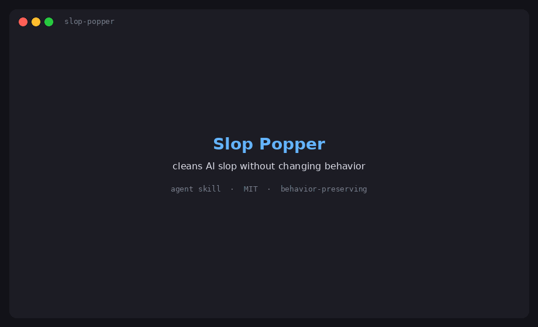

# Slop Popper

[](https://ko-fi.com/A4Q728XPQ3) [](https://buymeacoffee.com/j7labs)


An agent skill that cleans AI-generated slop out of working code without changing what the code does.

"Slop" is code that runs but carries noise a careful person wouldn't write: dead code, duplication, pass-through wrappers, defensive clutter, vague names, chatty logs, placeholder content, and noisy comments. Slop Popper removes it in small, test-checked passes. It's cleanup, not a rewrite.

## What it does

- **Applies safe fixes automatically:** deleting dead or duplicate code, fixing vague names, removing wrappers that only pass calls through, moving code to the module it belongs in, and removing noise comments and debug output.
- **Holds riskier changes for your review:** signature, logic, or config changes, public renames, whole-file reformatting, and deleting code that only tests use. Each held item gets an ID you can approve or reject.
- **Protects behavior:** it checks tests first and allows no new failures, works one category at a time, and stops for approval when a run gets large.
- **Follows your project:** it reads your style guide, lint configs, and a keep list (`KEEP.md` or `.deslopkeep`) of things it must never touch.
- **Never commits for you,** and it never copies secret values into its reports.

## Commands

| Command | What it does |
|---|---|
| `/deslop` | Quick pre-commit cleanup of staged changes, with no questions and a short report |
| `/deslop-full [path]` | The full routine on a path or the whole repo |
| `/deslop-since <commit or tag>` | Full cleanup of everything changed since that point |
| `/deslop-review` | Reviews someone else's cleanup without editing |
| `/deslop-approve <IDs \| all>` | Applies held items you approve |
| `/deslop-reject <IDs>` | Closes held items you want left as they are |
| `--dry-run` | Added to any command: shows the plan without changing anything |

## Install

Copy the `slop-popper` folder into your agent's skills folder so the file ends up at `.claude/skills/slop-popper/SKILL.md` (or the same `slop-popper/SKILL.md` path wherever your coding agent loads skills from). Keep the folder name lowercase and matching the skill's `name`, or it won't install.

Quick install for Claude Code, from your project folder:

```
git clone https://github.com/J7-Tech/Slop-Popper
mkdir -p .claude/skills
cp -r Slop-Popper/slop-popper .claude/skills/
```

Then type `/deslop` before a commit, or ask it to "deslop this module."

## Works with

Any language. It includes comment conventions and common checkers for Python, JavaScript and TypeScript, C#, Java and Kotlin, Go, and Rust, and it works without git or tests by falling back to safer, review-only behavior.

## Support

Slop Popper is free. If it saved you some cleanup time, you can support future projects through [Ko-fi](https://ko-fi.com/A4Q728XPQ3) or [Buy Me a Coffee](https://buymeacoffee.com/j7labs). Bug reports and ideas are welcome in [Issues](https://github.com/J7-Tech/Slop-Popper/issues).

## License

[MIT](LICENSE)